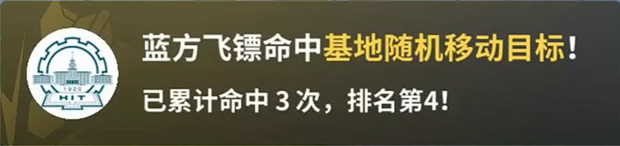
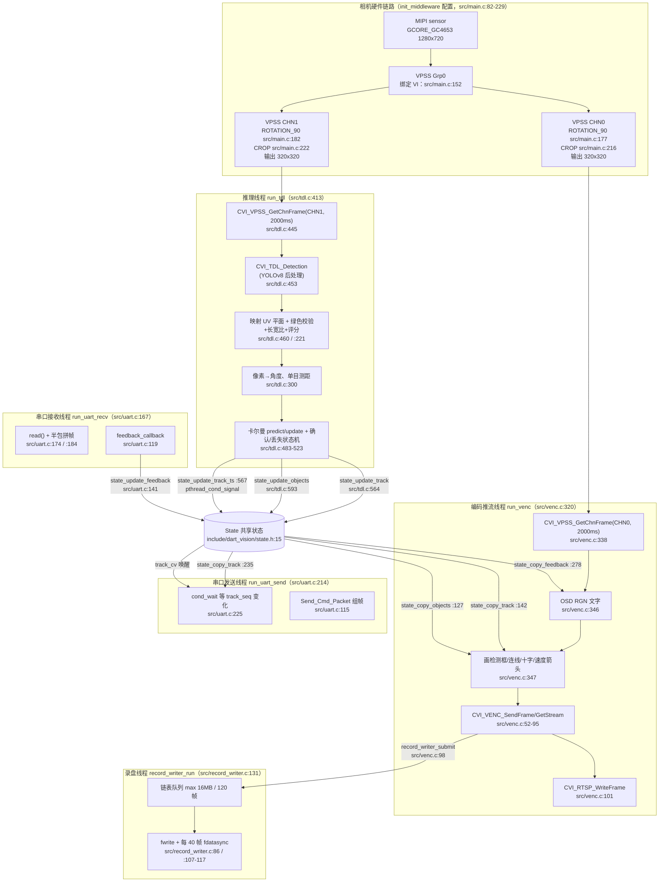
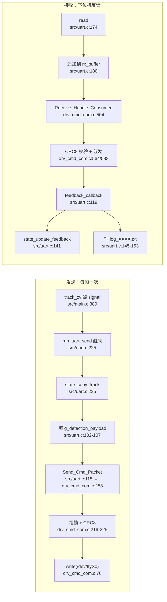

# 【RM2026 - 基于 LicheeRV Nano 的镖体视觉系统】哈尔滨工业大学（威海）HERO 战队

<p>
  <a href="LICENSE"></a>
  
  
  
  
</p>

面向 RoboMaster **制导镖**的**镖体视觉系统**：在一块 **LicheeRV Nano**（算能 SG2002，1 GHz RISC-V C906 + 1 TOPS INT8 NPU）上单进程完成 「NPU 神经网络初筛 → CPU 两级传统视觉复筛 → 卡尔曼滤波跟踪 → 串口输出角度」，320×320 分辨率下跑满传感器的 **83 FPS** 上限，同时用硬件 H.264 编码器推 RTSP 供调参、把码流与电控日志内录到 TF 卡供赛后复盘。**内录查看、参数调试与修改简单易学，机械/电控的同学也能上手查看内录与简单调试。**

> 本项目及文档以 vibe coding / AI 辅助开发为主，若存在缺陷，敬请谅解。

## 快速开始

### 0. 你需要准备什么

**硬件**

| 项       | 本项目使用                                                   | 说明                                                         |
| -------- | ------------------------------------------------------------ | ------------------------------------------------------------ |
| 主控     | Sipeed LicheeRV-Nano-B（SG2002：1 GHz RISC-V C906 + 1 TOPS INT8 NPU） | 单板完成取图、推理、编码、通信                               |
| 摄像头   | MIPI CSI + GC4653 + 4mm M12 镜头                             | `/mnt/data/sensor_cfg.ini` 内修改摄像头配置文件（默认是 2K@30fps，需要手动修改为 720P@60fps） |
| 存储     | TF 卡（系统镜像 + 内录 + 日志）                              | 掉卡会导致内录丢帧，见[已知限制](#已知限制与优化方向)        |
| 外部接口 | 调试串口 / **USB-C**（自动创建虚拟网卡）                     | 调试链路全部走网络：RTSP、SSH                                |
| 系统镜像 | 第三方镜像（含更多摄像头配置文件）：<https://github.com/scpcom/LicheeSG-Nano-Build> | 本队采用的是 26 年初的某一个版本                             |
| 下位机   | 任意 MCU / 电控板，UART0 115200 8N1                          | 本项目仅完成引导灯的识别与解算，具体姿态控制在下位机执行     |
| 开发机   | Linux x86_64                                                 | 仅用于交叉编译与相机标定                                     |

**开发机软件**

| 依赖                 | 版本（实测）                                                 | 用途                                            |
| -------------------- | ------------------------------------------------------------ | ----------------------------------------------- |
| 交叉工具链           | `riscv64-unknown-linux-musl-gcc` 10.2.0（Xuantie-900 Toolchain V2.6.1） | 生成 RISC-V musl 可执行文件                     |
| CMake / Ninja        | 4.4.5 / 1.13.2（CMake 要求 ≥ 3.15）                          | 构建                                            |
| Python（标定、字模） | 3.10+，`opencv-python`、`numpy`                              | `scripts/cam_calib/`、`scripts/gen_osd_font.py` |

> 更多资料：[Sipeed WIKI](https://wiki.sipeed.com/hardware/zh/lichee/RV_Nano/1_intro.html)

### 1. 准备交叉工具链

工具链下载：<https://sophon-file.sophon.cn/sophon-prod-s3/drive/23/03/07/16/host-tools.tar.gz>

```bash
# 解压后把 COMPILER 指向工具链的 bin 目录
export COMPILER=/opt/riscv64-linux-musl/bin

# 校验：下面两个文件都应存在
ls "$COMPILER/riscv64-unknown-linux-musl-gcc" "$COMPILER/riscv64-unknown-linux-musl-g++"
```

注意是 **musl** 工具链。

### 2. 获取 SDK

体积较大，约 560 MB，附在本仓库的 **Release** 中，
下载后按下面的方式放进 `sdk/`：

```bash
# 方式 A：从下载的压缩包解压
./scripts/fetch_sdk.sh --tarball ~/Downloads/dartvision-sdk-*.tar.gz

# 方式 B：已经有解压好的 SDK 目录，建软链（零拷贝）
./scripts/fetch_sdk.sh --from-dir /path/to/sophgo-sdk

# 方式 C：直接从 URL 下载
./scripts/fetch_sdk.sh --url https://example.com/dartvision-sdk.tar.gz

# 任何时候都可以检查 sdk/ 是否完整
./scripts/fetch_sdk.sh --check     # 期望输出：SDK 安装完整
```

装好后 `sdk/` 下应有 6 个子目录：`tdl_sdk/ middleware/ osdrv/ cvi_rtsp/ opencv/ prebuilt/`。

### 3. 编译

```bash
cmake -S . -B build -G Ninja
cmake --build build
```

产物是 `build/bin/dart_vision`（约 124 KB）。可以顺手确认一下架构：

```bash
file build/bin/dart_vision   # 期望：ELF 64-bit LSB executable, UCB RISC-V ... /lib/ld-musl-riscv64xthead.so.1
```

### 4. 部署到开发板

**4.1. 烧录镜像**：

把[第三方镜像](https://github.com/scpcom/LicheeSG-Nano-Build)烧进 TF 卡，并复制替换其中的部分内容。

**4.2. 拷贝文件**：

```bash
# 将 assets/files 中的文件复制/替换到 TF 卡对应位置
cp -r assets/files/boot/.  <boot分区>
cp -r assets/files/root/.  <TF卡挂载点>/root/
# 下文 4.3, 4.4 中的路径均指代板子中的路径，这两步放到后面 ssh 进去再改也可以。
```

**4.3. 改传感器配置**：编辑板端 `/mnt/data/sensor_cfg.ini`，把 `name` 改成
`GCORE_GC4653_MIPI_720P_60FPS_10BIT`。
（实测添加环境变量 `MAIX_SENSOR_FPS=80` 可以提高帧率至 83 fps 左右）。

**4.4. 关闭串口日志输出**：本项目使用 `/dev/ttyS0` 与下位机通信，
而系统默认通过该串口发送日志，需要关掉输出（如用其他串口则无影响）——`/boot/uEnv.txt` 里写 `consoledev=null`（`assets/files/boot/uEnv.txt`
已经是这个内容），并注释掉 `/etc/inittab` 里对应的 `getty` 行。详细步骤见
[assets/files/Instruction.md](assets/files/Instruction.md)。

### 5. 运行

**5.1. 获取开发板 IP**

```bash
# 方法一：看新冒出来的网卡
ip a            # Linux；Windows 用 ipconfig
#   电脑这一侧一般是 10.xxx.xxx.100
#   开发板一般是这一小段网络的网关，通常为 10.xxx.xxx.1（以 ip a 实际显示为准）
#   用户名：root，密码：root
ssh root@10.xxx.xxx.1

# 方法二：板端 avahi-daemon 会广播主机名，靠 mDNS 查
avahi-browse -a | grep -i licheervnano
#   拿到地址后同样 ssh root@licheervnano-xxxx.local
```

**5.2. 运行**

```bash
# 在板端运行；参数 1 是模型路径
MAIX_SENSOR_FPS=80 /root/dart_vision /root/model/ydd_home3_320_320_cv181x_int8_sym.cvimodel

# --raw：不做叠加绘制，RTSP 输出纯净画面
MAIX_SENSOR_FPS=80 /root/dart_vision /root/model/ydd_home3_320_320_cv181x_int8_sym.cvimodel --raw
```

赛中我们使用 `ydd_home3_320_320_cv181x_int8_sym.cvimodel` 这个模型。

配置文件默认从 `/root/config/` 读取。内录与日志默认存放在 `/root/record/`。

**开机自启**：把 `assets/files/Instruction.md` 里的 `/etc/init.d/S99dart_vision` 脚本放进板端
`/etc/init.d/` 并 `chmod +x`，即可上电自动跑。

### 6. 验证是否跑通

```bash
# ① 看实时画面
ffplay rtsp://<板子IP>/h264     # 或 vlc rtsp://<板子IP>/h264

# ② 看串口是否在发数据（默认 UART0）

# ③ 开录制后确认文件在生成，可用 VLC 播放
ls -l /root/record_*.h264 /root/log_*.txt
```

| 输出     | 位置                             | 说明                                     |
| -------- | -------------------------------- | ---------------------------------------- |
| RTSP 流  | `rtsp://<board>/h264`        | H.264 实时画面，可带检测框/轨迹/角度文字 |
| 串口     | `/dev/ttyS0`                     | 每帧一个 `DetectionPacket`（见[串口协议](#串口协议)） |
| 录像     | `<record.path>/record_XXXX.h264` | 需在 `config.json` 打开 `record.enable`；序号递增至 9999，每 40 帧落盘一次 |
| 反馈日志 | `<record.path>/log_XXXX.txt`     | 下位机反馈包，带时间戳                   |

## 配置说明

配置分两个文件，均放在 `DART_VISION_CONFIG_DIR`（默认 `/root/config/`）：

### app 配置 `config.json`

键名是**嵌套结构**。代码读取时使用 cJSON 查找，缺失的键会静默使用默认值，
所以修改后请核对拼写（写错不会报错，只会不生效）。

| 键                                                | 代码默认值             | 说明                                               |
| ------------------------------------------------- | ---------------------- | -------------------------------------------------- |
| `exposure.manual_exposure_time_us`                | `500`                  | 手动曝光时间（微秒），同时锁定增益                 |
| `exposure.auto_target_luma`                       | `30`                   | 预留：自动曝光目标亮度，当前默认走手动曝光，未启用 |
| `model.threshold`                                 | `0.001`                | 模型置信度阈值（0~1，越小越敏感）；代码默认 `0.001`，赛中实际用 `0.01` |
| `optical_axis_compensation.yaw_deg`               | `0`                    | 光轴偏航补偿（度），叠加到输出角度上               |
| `optical_axis_compensation.pitch_deg`             | `0`                    | 光轴俯仰补偿（度）                                 |
| `record.enable`                                   | `false`                | 是否录制 H.264                                     |
| `record.log_enable`                               | `false`                | 是否把下位机反馈写入日志                           |
| `record.path`                                     | `/root`                | 录像与日志目录                                     |
| `tracker.process_noise.yaw` / `.pitch`            | `0.05`                 | 过程噪声**标准差**（代码内部平方成方差后使用）     |
| `tracker.measurement_noise.yaw` / `.pitch`        | `0.5`                  | 测量噪声方差                                       |
| `tracker.initial_covariance.yaw` / `.pitch`       | `10`                   | 初始位置协方差                                     |
| `tracker.initial_covariance.v_yaw` / `.v_pitch`   | `2`                    | 初始速度协方差                                     |
| `tracker.state_machine.min_confirm_frames`        | `3`                    | 连续命中多少帧才判定"跟踪成立"                     |
| `tracker.state_machine.lost_frames`               | `10`                   | 连续丢失多少帧才判定"目标丢失"                     |
| `tracker.state_machine.aspect_ratio_thresh`       | `1.5`                  | 目标框长宽比上限，超出的候选直接丢弃               |
| `tracker.timing.dt_default` / `dt_min` / `dt_max` | `1/30`、`1/200`、`1/5` | 帧间隔（秒）的默认值与钳位范围                     |
| `tracker.selection.confidence_weight`             | `0.6`                  | 候选评分里置信度的权重，其余给"与预测位置的邻近度" |

`tracker` 段可以整体省略，此时以上键都从 JSON 根读取（兼容旧配置）。

> ⚠️ **上表是代码里的兜底默认值，不是仓库里那份配置的值。**
> 仓库 `assets/files/root/config/config.json` 是比赛现场实际在用的一份，与上表默认值不同：
> 手动曝光 `1000 µs`、`model.threshold` `0.01`、`record.enable` `true`、`record.path` `/root/record`、
> `tracker.process_noise` `50`、`tracker.measurement_noise` `0.001`、`min_confirm_frames` `5`、`lost_frames` `10`。
> 换言之：**默认值是保底，仓库里这份才是赛场上跑的那套**；换赛季/换场地时需要重新整定。

#### 内录与日志的落盘行为（代码常量，不可通过 JSON 配置）

| 项 | 值 | 位置 |
|----|----|------|
| 写盘队列上限 | 16 MiB / 120 帧 | `src/main.c:686-690` |
| 刷盘间隔 | 每 40 帧 `fflush` + `fdatasync`（并打印本次耗时） | `src/record_writer.c:107-127` |
| 队列溢出 / 写失败 | 丢弃并进入"等下一个 IDR"，从关键帧重新开始写（不会留半截无法解码的 h264） | `src/record_writer.c:196-256` |
| 退出时 | 补一次 `fflush` + `fdatasync`，并输出 submitted/written/dropped 等统计 | `src/record_writer.c:158-169` |
| 日志刷盘 | 每 30 条 `fflush`（仅 `fflush`，不做 `fdatasync`） | `src/uart.c:144-151` |

想看丢帧情况：`record_writer_submit` 里 `dropped_frames` / `dropped_waiting_idr` / `peak_queued_frames` 会把
"队列打满"和"等 IDR 丢帧"分开计数，TF 卡慢或松动时这两个数会明显上涨。

### 相机内参 `camera_info.json`

由 [相机标定](#相机标定) 生成，OpenCV 标准格式：

```json
{
  "camera_matrix": [[1023.2189, 0.0, 643.8237],
                    [0.0, 1022.1671, 382.7521],
                    [0.0, 0.0, 1.0]],
  "distortion_coefficients": [-0.4473, 0.28302, 0.000208, -0.00102, -0.1197]
}
```

代码只读取 `camera_matrix` 的 `fx/cx/fy/cy`（行优先 3×3，也兼容展开成 9 个数字的写法），
`distortion_coefficients` 仅作记录、当前未做去畸变。内参不对会直接导致角度系统性偏差，
换镜头/改分辨率后必须重新标定。

## 串口协议

物理层：`/dev/ttyS0`，115200 8N1。帧格式（所有字段小端）：

```
| SOF 0xAA | DataLength(u16) | Seq(u8) | CRC8(u8) | CmdID(u16) | Data(DataLength) |
```

- `CRC8` 覆盖帧头前 4 字节（`SOF`、`DataLength`、`Seq`），初值由 `CRC8_INIT` 给出
- `DataLength` 只统计 `Data` 部分的字节数
- 发送与接收使用同一套帧格式，`CmdID` 区分方向

### 上行（板 → 下位机）`CMD_ID 0x01`：`DetectionPacket_t`（21 字节，1 字节对齐）

| 字段       | 类型      | 说明                       |
| ---------- | --------- | -------------------------- |
| `detected` | `uint8`   | 是否识别到目标（1/0）      |
| `yaw`      | `float32` | 偏航角（度），已加光轴补偿 |
| `pitch`    | `float32` | 俯仰角（度），已加光轴补偿 |
| `v_yaw`    | `float32` | 偏航角速度（度/秒）        |
| `v_pitch`  | `float32` | 俯仰角速度（度/秒）        |
| `distance` | `float32` | 目标距离（米）             |

未检测到目标时仍会按帧发送（`detected=0`，其余置 0），下位机可据此判断链路存活。

### 下行（下位机 → 板）`CMD_ID 0x02`：`FeedbackPacket_t`（16 字节）

| 字段              | 类型      | 说明                                       |
| ----------------- | --------- | ------------------------------------------ |
| `data1` ~ `data4` | `float32` | 4 个通用浮点通道，具体含义由下位机协议约定 |

历史版本这里曾是 `u/v/w/Pitch/Yaw` 等具名字段，现在统一为 `data1..data4`，
在 `src/uart.c` 的 `feedback_callback()` 里按需解释并写入日志。
**改动协议必须与电控端同步**，并同步更新本节与 `include/dart_vision/visual_data.h`。

## 相机标定

标定是"PC 收图 + 板端推图"的客户端/服务端模式，链路走 TCP 8899：

```bash
# 1) 板端启动推流脚本（依赖 MaixPy，随板卡镜像提供）
python3 scripts/cam_calib/cam_stream.py

# 2) PC 端采集并计算内参（依赖 opencv-python / numpy）
pip install -r scripts/cam_calib/requirements.txt
python3 scripts/cam_calib/main.py --host <板子IP>

# 常用参数
python3 scripts/cam_calib/main.py --host 192.168.1.100 \
        --port 8899 --cols 6 --rows 9 --square-mm 29.2 \
        --output-dir calib_out_$(date +%Y%m%d)
```

采集够 15 张以上不同姿态的棋盘格图像后按 `q` 计算，结果写到
`calib_output_<时间戳>/`，其中 `camera_info.json` 可直接替换板端
`/root/config/camera_info.json`。也可以只设环境变量 `DART_BOARD_IP` 省掉 `--host`。

## 训练与模型导出

仓库只带赛中实际使用的那个权重 `assets/files/root/model/ydd_home3_320_320_cv181x_int8_sym.cvimodel`，
**不含训练代码**——训练在 PC 上用 Ultralytics 完成，导出与量化用厂商工具链。
完整流程如下，供复现或换目标时参考。

### 1. 数据采集与标注

本项目的数据集由两部分构成，合计上万张：

- **往年赛季通过工业相机拍摄的的引导灯实拍图**；
- **用 GC4653 摄像头拍摄的队内自制基地模型引导灯图**。

### 2. 训练

模型选 **YOLO11n**（320×320 在 SG2002 NPU 上单帧约 10 ms）：

两个我们实践下来有效的细节：

1. **数据集增强模拟飞行画面**：加**椒盐噪声**与**拖影**，模拟制导镖高速飞行时相机拍到的真实画面；
2. **把工业相机拍摄的引导灯图片随机缩放到合适的尺寸范围**，避免引导灯因距离太远、目标太小，
   而在 320×320 训练分辨率下丢失特征。

### 3. 导出 并量化校准

参考资料：

- https://doc.sophgo.com/cvitek-develop-docs/master/docs_latest_release/CV180x_CV181x/zh/01.software/TPU/YOLO_Development_Guide/build/html/6_Yolov8_development.html
- https://medium.com/@ret7020/licheerv-nano-running-yolo-5de8d2a39776

## 效果展示

见视频：https://www.bilibili.com/video/BV1Jf7f6UEdA/

## 竞赛成绩



26 赛季分区赛全队共发射 8 次制导镖、3 次成功命中。累计命中基地随机移动目标数**北部赛区第一、全国第四**，获得飞镖组兵种一等奖。

## 项目背景

在 26 赛季中，制导镖无论在数值表现还是战略意义上均已明显超过机械镖，成为队内重点投入方向。此前队伍在该方向几乎无技术积累，因此开始重点研发。

考虑到硬件选型限制，以及作者本人同时承担多项任务、难以保证随时到场调试，本项目希望在受限算力平台上构建一套满足实时帧率要求、误报率可控、调参与复盘门槛较低的系统，以降低现场调试和后续维护成本。

### 关键技术指标

| 指标         | 数值                                                         | 依据                                                         |
| ------------ | ------------------------------------------------------------ | ------------------------------------------------------------ |
| 推理输入     | 320 × 320，INT8 量化                                         | `include/dart_vision/config.h:14-15`、`src/tdl.c:377-398`    |
| 单帧推理延迟 | 约 **10 ms**（YOLO11n，320×320，INT8）                       | 实测                                                         |
| 端到端帧率   | **83 FPS**（传感器帧率上限）                                 | 实测；候选框超过 6 个时可能降到 60 左右                      |
| 检测类别     | 单类（引导灯）                                               | `MODEL_CLASS_CNT`                                            |
| 单帧候选上限 | 3                                                            | `MODEL_MAX_DET`                                              |
| 置信度阈值   | 0.01（赛中）                                                 | `MODEL_THRESH_DEFAULT`、`config.json` 的 `model.threshold`   |
| 工作线程     | 5（推理 / 编码 / 串口收发 ×2 / 录盘）                        | `src/main.c:727-742`、`src/record_writer.c:189`              |
| 串口         | `/dev/ttyS0`，115200 8N1，上行 21 B/包                       | `include/dart_vision/config.h:36-37`、`include/dart_vision/visual_data.h` |
| 预览         | `rtsp://<板卡IP>/h264`，硬件编码                             | `src/middleware_utils.c:88`、`:315`                          |
| 内录 / 日志  | `record_XXXX.h264` / `log_XXXX.txt`；内录队列 16 MiB / 120 帧、每 40 帧 `fflush`+`fdatasync`；日志每 30 条 `fflush` | `src/main.c:686-690`、`src/record_writer.c:107-127`、`src/uart.c:144-151` |
| 代码规模     | 应用逻辑 4.5k 行 C（另含 cJSON 3.2k）/ 产物 124 KB           | `wc -l`、`file build/bin/dart_vision`                        |
| 主机端依赖   | CMake ≥ 3.15、RISC-V musl 交叉工具链                         | `CMakeLists.txt:1-40`                                        |

## 需求与指标

赛季初列出的功能需求与性能指标（镖体视觉）：

| #   | 需求                                                         | 达成情况                                             |
| --- | ------------------------------------------------------------ | ---------------------------------------------------- |
| 1   | 识别推理帧率稳定达到相机传感器上限（83 FPS）                 | ✅ 达成                                               |
| 2   | 极限识别距离达到 20 m                                        | ✅ 达成（靠极低阈值 + 复筛，见[算法实现](#算法实现)） |
| 3   | 稳定识别距离达到 15 m                                        | ✅ 达成                                               |
| 4   | 对常见误识别内容（安全出口灯、机器人绿色灯条等）具备滤除能力 | ✅ 由 YUV 绿色校验 + 长宽比约束实现                   |
| 5   | 程序在震荡工况（发射、落地）中稳定运行                       | ✅ 达成                                               |

调试与日志需求（因为需要"零基础上手"，交给其他队员也能用）：

| #   | 需求                                                                               | 实现                                              |
| --- | ---------------------------------------------------------------------------------- | ------------------------------------------------- |
| 1   | 易操作的实时画面推流与内录查看                                                     | RTSP 推流 + TF 卡 H.264 内录，VLC / ffplay 直接看 |
| 2   | 简单易修改的参数配置                                                               | 单份 `config.json`（cJSON），关键参数全部集中     |
| 3   | 完善的日志系统，可实时记录下位机通过串口发来的日志，并按时间戳对应附于内录图像帧上 | 已验证，且无须额外配置环境，可零基础上手查看日志  |

设计原则是**零门槛**：其他队员不需要搭 RISC-V 交叉编译工具链、不需要装专用 IDE，
用 ffmpeg 工具链和系统自带 SSH 就能查看实时识别画面、内录日志与参数，随便借用一台电脑均能展开调试。（一般撰写一篇文档 + 手把手演示一次均能学会）

## 软件功能

整套系统在单块板卡、单个进程内闭环，主要功能点：

| 功能                     | 说明                                                         |
| ------------------------ | ------------------------------------------------------------ |
| **端侧全流程闭环**       | 取图 → NPU 推理 → 两级复筛 → 角度解算 → 卡尔曼跟踪 → 串口输出，全部在板端完成 |
| **83 FPS 实时处理**      | 320×320 下跑满传感器帧率上限，从取帧到串口发出约 **13 ms**（NPU 推理 10 ms + 复筛 ~1 ms + 解算/滤波 ~0.7 ms + 串口 1.8 ms） |
| **异构算力协同**         | NPU 承担神经网络初筛，CPU 承担低开销的传统视觉复筛，两者互补解决"召回率 vs 误检率"矛盾 |
| **旋转取图扩大制导窗口** | 利用摄像头横向视角较大的特点，将相机顺时针旋转 90° 安装后裁剪画面，把横向画幅换成俯仰视场，扩大俯角视野，从而延长可制导距离 |
| **卡尔曼跟踪 + 状态机**  | 丢失容忍期内只预测不更新，目标被短暂遮挡时控制指令不中断     |
| **可视化调试体系**       | RTSP 实时推流（叠加检测框/速度箭头/OSD 文字）+ TF 卡内录 H.264 + 电控日志落盘，可逐帧复盘 |
| **单文件 JSON 配置**     | 曝光、光轴补偿、阈值、卡尔曼全部参数集中在一份 `config.json`，改完重启程序即可 |

## 项目结构

```
DartVision/
├── CMakeLists.txt              # 交叉编译入口（校验工具链与 SDK，给出可读的报错）
├── src/
│   ├── main.c                  # 进程启动：解析参数、初始化、起线程、退出清理
│   ├── config.c                # config.json / camera_info.json 解析（cJSON）
│   ├── tdl.c                   # 推理线程：YOLO11n → 两级复筛 → 角度/测距 → 卡尔曼
│   ├── venc.c                  # 编码线程：叠加绘制 → H.264 → RTSP → 录像入队
│   ├── uart.c                  # 串口收发线程与协议回调
│   ├── kalman.c                # 卡尔曼滤波与确认/丢失状态机
│   ├── record_writer.c         # 录像写盘线程（缓冲队列 + 刷盘节流 + IDR 对齐）
│   ├── osd_rgn.c               # OSD 区域叠加（8 行文字）
│   ├── middleware_utils.c      # VI/VPSS/VENC/RTSP 初始化（派生自 SDK 示例，见第三方声明）
│   ├── sample_utils.c          # SDK 示例工具函数（派生自 SDK 示例）
│   ├── cJSON.c                 # JSON 解析库（MIT，第三方）
│   └── serial/                 # 串口协议栈：帧头 / CRC8 / 命令注册与分发
├── include/
│   ├── dart_vision/            # 应用头文件：config / state / uart / venc / tdl /
│   │                           #   kalman / visual_data（协议包结构）/ debug
│   ├── tool/                   # 串口协议栈头文件（drv_cmd_com.h / drv_CRC.h）
│   └── (src/osd_font8x12.h)    # OSD 8×12 字模（由 Noto Sans Mono 生成，OFL 1.1）
├── scripts/
│   ├── fetch_sdk.sh            # 校验 / 导入平台 SDK（--from-dir / --tarball / --url / --check）
│   ├── gen_osd_font.py         # 字模生成（依赖 ImageMagick + Noto Sans Mono，OFL）
│   └── cam_calib/              # 相机标定：板端推流 + PC 端计算内参
├── assets/files/               # 板端部署镜像：root/(config, model) + boot/(uEnv.txt 等)
├── docs/                        # 展示素材：achievement.png、hit.mp4
├── sdk/                        # 平台 SDK 落地目录（.gitignore 忽略，仅保留 README 说明）
├── LICENSE                     # MIT
└── THIRD_PARTY_NOTICES.md      # 第三方代码与许可证清单
```

## 方案选型：为什么不用纯传统视觉或纯神经网络

赛季初针对 SG2002 这块板子实测了两条纯路线，结果都不满足要求：

| 方案                            | 实测表现                                | 问题                                                                                                                     |
| ------------------------------- | --------------------------------------- | ------------------------------------------------------------------------------------------------------------------------ |
| 纯传统视觉（颜色 + 轮廓，全图） | 320×320 下**不到 20 FPS**               | CPU 算力不支持全图传统视觉识别，帧率远低于传感器上限                                                                     |
| 纯神经网络                      | 320×320 下可达**摄像头帧率上限 83 FPS** | 对模型训练要求极高：**提高置信度阈值 → 极限检测距离过近；降低阈值 → 误检太多**。赛场数据集较少，无法训练出效果理想的模型 |

单靠任何一条都走不通：传统视觉算不动，纯神经网络在"远距离"和"低误报"之间没有可调空间。
于是采用**异构混合 pipeline**：把适合 NPU 的部分给 NPU，适合 CPU 的部分给 CPU——

- **NPU 高召回初筛**：轻量网络 + 极低置信度阈值（赛中 0.01），把"可能是引导灯的候选"全部捞出来；
- **CPU 两级复筛**：对每个候选做**长宽比**与**YUV 绿色**双重校验，算力开销极小；
- **卡尔曼运动先验**：用历史轨迹在多个候选中挑出最连续的那个作为最终目标。

该方案的优缺点（自我评估）：

| 维度     | 评价       | 说明                                                         |
| -------- | ---------- | ------------------------------------------------------------ |
| 性能开销 | 适中       | 充分利用 CPU 与 NPU 的异构算力，实时性好，帧率可顶到传感器上限。但当神经网络候选项较多或面积较大时，帧率可能跌破 60（比赛场景下不会出现） |
| 准确性   | 较高       | 结合了神经网络高召回率与传统视觉高准确率的优势               |
| 适用性   | 中等       | 在干扰项较多的背景下调参依然较为困难；但对于神经网络模型质量要求低，且比赛场景下识别干扰项较少，鲁棒性可接受 |
| 复杂度   | 开发难度高 | 板子资料少、可用库极少，YUV 验证、坐标变换等均需从底层自行实现 |

## 整体流程

本项目是单进程、多线程的流水线：相机数据由 **VPSS 硬件**分成两路（推理 / 编码），
两路各自由独立线程拉帧，检测与跟踪结果通过 `State`（`include/dart_vision/state.h`）
在线程间共享，串口收发又各占一个线程。下图是全局数据流：



### 进程与线程

`main()`（`src/main.c:572`）自身不处理任何数据，只负责初始化、起线程、等线程退出、按逆序释放。
运行时一共 **5 个工作线程**，全部通过 `State` 交换数据，没有全局裸变量（串口驱动的静态命令表除外）：

| #   | 线程     | 入口函数                                      | 创建位置                                              | 阻塞点                                                                                               | 读 / 写共享状态                                                            | 职责                                                 |
| --- | -------- | --------------------------------------------- | ----------------------------------------------------- | ---------------------------------------------------------------------------------------------------- | -------------------------------------------------------------------------- | ---------------------------------------------------- |
| 1   | 推理     | `run_tdl` `src/tdl.c:413`                     | `src/main.c:742`                                      | `CVI_VPSS_GetChnFrame` 超时 2000 ms（`src/tdl.c:445`）                                               | 写 `last_obj` `src/tdl.c:593`、`track` `:564`、`track_ts/track_seq` `:567` | 取 CHN1 帧 → YOLO11n → 两级复筛 → 角度/测距 → 卡尔曼 |
| 2   | 编码推流 | `run_venc` `src/venc.c:320`                   | `src/main.c:737`                                      | `CVI_VPSS_GetChnFrame` 2000 ms（`src/venc.c:338`）、`CVI_VENC_GetStream` 10000 ms（`src/venc.c:80`） | 读 `last_obj` `:127`、`track` `:142`、`feedback` `:278`；写录像队列 `:98`  | 取 CHN0 帧 → OSD/叠加 → H.264 → RTSP + 录制入队      |
| 3   | 串口发送 | `run_uart_send` `src/uart.c:214`              | `src/main.c:732`                                      | `pthread_cond_wait(&track_cv)` `src/uart.c:225`                                                      | 读 `track` `:235`、`track_seq` `:226`                                      | 每有一次新的滤波输出就发一帧 `DetectionPacket`       |
| 4   | 串口接收 | `run_uart_recv` `src/uart.c:167`              | `src/main.c:727`                                      | `read()`（阻塞，`VMIN=0/TIME=10`，`src/uart.c:85-90`）                                               | 写 `feedback` `:141`、日志文件 `:145`                                      | 拼包解帧 → `feedback_callback`                       |
| 5   | 录像落盘 | `record_writer_run` `src/record_writer.c:131` | `src/record_writer.c:189`（由 `src/main.c:692` 触发） | `pthread_cond_wait` `:138`、`fdatasync` `:117`                                                       | 只碰自己的链表与 `FILE*`                                                   | 消费码流队列写 `record_XXXX.h264`                    |

> RTSP 的会话与推流都在工作线程里完成（`src/venc.c:101`），SDK 内部不再另起用户线程。
> 串口回调 `feedback_callback` 是在**接收线程**语境里同步执行的（`src/serial/drv_cmd_com.c:413`），
> 因此它里面写文件不会额外引入线程。

### 启动时序（`main()`）

| 行号                  | 动作                                                                                                  | 失败时                                                   |
| --------------------- | ----------------------------------------------------------------------------------------------------- | -------------------------------------------------------- |
| `src/main.c:574`      | `parse_args()` 解析 `模型路径 [--raw]`（`:56`）                                                       | 打印用法并退出                                           |
| `:582`                | `resolve_config_paths()`（`:440`）拼出 `$DART_VISION_CONFIG_DIR` 或 `/root/config` 下的两个文件路径   | —                                                        |
| `:586-587`            | `signal(SIGINT/SIGTERM, handle_signal)`（`:37`）                                                      | —                                                        |
| `:590`                | `state_init()`（`:271`）：清零、建 3 把锁 + 1 个条件变量、`kalman_config_init()`                      | —                                                        |
| `:593`                | `load_camera_info()`（`src/config.c:149`，cJSON 解析 3×3 内参）                                       | 打印错误后退出                                           |
| `:600-604`            | `config_set_defaults()` → `load_app_config()` → `config_sanitize()`                                   | 配置缺失只警告，继续用默认值                             |
| `:611`                | `load_kalman_config()`（`src/kalman.c`，读 `tracker` 段）                                             | 同上，缺失用默认参数                                     |
| `:618-630`            | `open_record_files()`（`:451`）按未占用的序号打开 `record_XXXX.h264` / `log_XXXX.txt`                 | 打不开则关闭对应功能                                     |
| `:633`                | `uart_init("/dev/ttyS0", 115200)`（`src/uart.c:26`）                                                  | 退出                                                     |
| `:640`                | `Attach_SendCmd(CMD_ID_DETECTION, ..., &g_detection_payload)`（`src/serial/drv_cmd_com.c:146`）       | 退出                                                     |
| `:646`                | `Attach_Receive_callback(CMD_ID_FEEDBACK, ..., feedback_callback)`（`:347`）                          | 退出                                                     |
| `:659`                | `init_middleware()`（`:82`）：VI/VPSS/VENC/RTSP + 裁剪 + 旋转                                         | 释放状态后退出                                           |
| `:664-668`            | 把 `crop_x/crop_y/crop_size` 与 `crop_scale = crop_size / 320` 写进 `State`                           | —                                                        |
| `:674`                | `set_manual_exposure(0, exposure_time_us)`（`:495`）：受限自动曝光，锁死曝光时间与 ISO                | 仅打印                                                   |
| `:678`                | `init_tdl()`（`:232`）：建句柄、绑 VBPool、加载 `.cvimodel`、设阈值/NMS                               | 释放中间件后退出                                         |
| `:685-701`            | `record_writer_init/start`（`max_bytes=16MB`、`max_frames=120`、`sync_interval=40`，`:686-690`）      | 回滚已初始化的资源后退出                                 |
| `:727/:732/:737/:742` | 依次创建 接收、发送、编码、推理 4 个线程                                                              | 任一失败即 `state_request_exit()` 并只 join 已创建的线程 |
| `:752-763`            | 4 个 `pthread_join`                                                                                   | —                                                        |
| `:765-784`            | 停录像线程、打印统计、释放                                                                            | —                                                        |
| `:786-789`            | `CVI_TDL_Service_DestroyHandle` → `CVI_TDL_DestroyHandle` → `SAMPLE_TDL_Destroy_MW` → `state_destroy` | —                                                        |

### 通道 A：VPSS → 推理 → 卡尔曼（`src/tdl.c`）

```mermaid
flowchart LR
    A["CHN1 320x320 帧<br/>CVI_VPSS_GetChnFrame src/tdl.c:445"] --> B["CVI_TDL_Detection<br/>src/tdl.c:453"]
    B --> C{"框数 > 0？<br/>src/tdl.c:466"}
    C -->|否| K["卡尔曼只外推<br/>src/tdl.c:509"]
    C -->|是| D["映射 UV 平面<br/>src/tdl.c:460"]
    D --> E["逐框：长宽比 :247<br/>绿色十字扫描 :203/:210<br/>置信度+距离加权 :257-266"]
    E --> F["取最高的框<br/>src/tdl.c:267-281"]
    F --> G["量测点 = 中心上方 1.5 倍框高<br/>src/tdl.c:317"]
    G --> H["反 90° 旋转 + 加裁剪偏移<br/>src/tdl.c:331-337"]
    H --> I["atan 反算 yaw/pitch，减光轴补偿<br/>src/tdl.c:342-369"]
    I --> J["kalman_predict/update<br/>src/tdl.c:492-493"]
    K --> L["状态机：确认/丢失计数<br/>src/tdl.c:497-523"]
    J --> L
    L --> M["换算回像素与像素速度<br/>src/tdl.c:540-544"]
    M --> N["state_update_track + track_ts<br/>src/tdl.c:564/:567"]
```



关键细节（都能在代码里对上）：

- **坐标系**：VPSS 对两路都做了 90° 顺时针旋转（`src/main.c:177/:182`）并裁剪成右侧正方形
  （`crop_size = min(W,H)`，`crop_x = W - crop_size - 180`，`src/main.c:189-195`）。
  因此推理图坐标 → 传感器坐标要"先乘 `crop_scale`、再逆旋转、再加 `crop_x/crop_y`"
  （`src/tdl.c:322-337`）；反向映射在 `src/tdl.c:76-91` 与绘制侧 `src/venc.c:155-171` 各写了一遍。
- **绿色校验**只读 NV12 的 UV 平面（`src/tdl.c:124-135`），阈值 `GREEN_UV_THRESH=125`
  （`include/dart_vision/config.h:19`），沿框中线做十字扫描、步长 2（`src/tdl.c:200-214`）；
  框太小（<4px）退化为取中心像素（`src/tdl.c:191-193`）。
- **评分**：`score = w·conf + (1-w)·(1 - 距离/画面对角线)`，`w = tracker.selection.confidence_weight`
  （`src/tdl.c:233-266`），只有卡尔曼已初始化时才叠加距离项（`src/tdl.c:257`）。
- **量测点**不是框中心，而是中心**上方** `1.5 × 框高`（`TARGET_UP_OFFSET_HEIGHT_FACTOR`，
  `src/tdl.c:317`），这样瞄的是引导灯本体而不是整个机构。
- **角度**：`yaw = -atan((y-c_y)/f_y)`、`pitch = atan((x-c_x)/f_x)`，再减去光轴补偿
  （`src/tdl.c:342-369`）；反向换算是 `x = tan(pitch)·f_x + c_x`、`y = -tan(yaw)·f_y + c_y`
  （`src/tdl.c:50-51`）。
- **测距**：`diameter_px = 0.5(w+h)·crop_scale`，`z = f·0.055 / diameter_px`，
  再合成三维距离（`src/tdl.c:346-365`）；本帧无有效测距时沿用上一次的值（`src/tdl.c:555-561`）。
- **状态机**：连续 `min_confirm_frames` 次命中才 `confirmed`，丢失后最多外推 `lost_frames` 帧，
  超时才复位（`src/tdl.c:483-523`）；`--raw` 不影响推理，只影响绘制（`src/venc.c:345`）。

### 通道 B：VPSS → 叠加 → 编码 / RTSP / 录制（`src/venc.c`）

| 步骤     | 位置                                                                              | 说明                                                                                                                                                                                             |
| -------- | --------------------------------------------------------------------------------- | ------------------------------------------------------------------------------------------------------------------------------------------------------------------------------------------------ |
| 取帧     | `src/venc.c:338`                                                                  | CHN0，320×320，超时 2 s                                                                                                                                                                          |
| OSD      | `src/venc.c:346` → `update_osd()` `:274` → `osd_rgn_update()` `src/osd_rgn.c:109` | 8 行文字：`Y: / P: / D: / data1-4 / 时间`（`src/venc.c:288-316`）；画布 104×320，写点时做逆时针旋转（`src/osd_rgn.c:18-20`），由 `CVI_RGN_AttachToChn` 挂到 VPSS Grp0 CHN0（`src/osd_rgn.c:83`） |
| 叠加     | `src/venc.c:347` → `draw_overlay()` `:116`                                        | 蓝框（原始检测 `CVI_TDL_Service_ObjectDrawRect` `:134`）、红线和目标/光心双十字（`:192-228`）、黄色速度箭头（`:231-268`，长度 `0.5×abs(v)`，限幅 6–80 px） |
| 送编码   | `src/venc.c:52`                                                                   | `CVI_VENC_SendFrame`（超时 20 s）                                                                                                                                                                |
| 取码流   | `src/venc.c:58-95`                                                                | `GetChnAttr` → `QueryStatus` → `malloc(packs)` → `GetStream`（10 s）→ pack 转 `CVI_RTSP_DATA`                                                                                                    |
| 录制入队 | `src/venc.c:98`                                                                   | 在 RTSP 写之前 `record_writer_submit`，深拷贝码流（`src/record_writer.c:36-75`），队列上限 16 MB / 120 帧（`src/main.c:687-688`）                                                                |
| 推流     | `src/venc.c:101`                                                                  | `CVI_RTSP_WriteFrame`，地址 `rtsp://<板卡IP>:554/h264`（端口 `src/middleware_utils.c:88`、通道名 `:315`）                                                                                        |
| 释放     | `src/venc.c:109-111`、`:364`                                                      | `ReleaseStream` → `free` → `ReleaseChnFrame`                                                                                                                                                     |

录像写盘在独立线程里：写失败会置 `accepting=false` 并等待下一个 IDR 再续写
（`src/record_writer.c:88-92`、`:218`），每 40 帧 `fflush`+`fdatasync` 一次（`:107-117`）。

### 通道 C：串口收发（`src/uart.c` + `src/serial/drv_cmd_com.c`）



- 发送线程用 `track_seq` 去重（`src/uart.c:226/:231`），所以**每次卡尔曼更新恰好发一帧**；
  未检测到目标时发 `detected=0` 的全零包（`src/uart.c:242`）。
- 组帧：`SOF(0xAA) + DataLength(u16) + Seq(u8) + CRC8(u8) + CmdID(u16) + payload`，
  CRC8 只覆盖前 4 字节（`src/serial/drv_cmd_com.c:222-225`）；CRC16 已注释掉（`:238-240`）。
- 收包支持半包：`Receive_Handle_Consumed()` 返回已消费字节数，剩余部分 `memmove` 回缓冲区头部
  （`src/uart.c:183-194`）；`DataLength > 1024` 视为错帧只跳 1 字节重新找 `0xAA`
  （`src/serial/drv_cmd_com.c:545-550`）。
- 反馈包解析后**同时**用于三处：OSD 显示 `data1..data4`（`src/venc.c:296-299`）、
  共享状态（供后续扩展）、文本日志（每 30 条 `fflush`，`src/uart.c:148-153`）。

### 共享状态与锁（`include/dart_vision/state.h:15`）

| 数据                                           | 写者                      | 读者                                                 | 保护方式                                                  |
| ---------------------------------------------- | ------------------------- | ---------------------------------------------------- | --------------------------------------------------------- |
| `last_obj`（原始检测）                         | 推理线程 `src/tdl.c:593`  | 编码线程 `src/venc.c:127`                            | `obj_mutex`（`src/main.c:330/:345`）                      |
| `track`（滤波输出）                            | 推理线程 `src/tdl.c:564`  | 编码线程 `src/venc.c:142`、串口线程 `src/uart.c:235` | `track_mutex`（`src/main.c:358/:369`）                    |
| `track_ts` / `track_seq`                       | 推理线程 `src/tdl.c:567`  | 串口线程 `src/uart.c:224`                            | `track_mutex` + `track_cv`（`src/main.c:380-391`）        |
| `feedback_data[4]`                             | 接收线程 `src/uart.c:141` | 编码线程 `src/venc.c:278`                            | `feedback_mutex`（`src/main.c:409/:421`）                 |
| `exit_requested`                               | 任意线程/信号处理         | 所有循环                                             | `volatile bool` + `track_cv` 广播（`src/main.c:317-324`） |
| `camera`、`crop_*`、`optical_axis_*`、`kf_cfg` | 主线程初始化后只读        | 全部                                                 | 无锁（初始化完成后不再改）                                |

### 退出路径

`Ctrl+C` / `SIGTERM` → `handle_signal`（`src/main.c:37`）→ `state_request_exit()`（`:317`）
置位 `exit_requested` 并 `pthread_cond_broadcast`，4 个循环各自检查 `state_should_exit()` 后退出
（`src/tdl.c:432`、`src/venc.c:336`、`src/uart.c:172/:221`）；
若取帧/推理/编码失败，工作线程也会主动调用 `state_request_exit()` 让整机一起停
（`src/tdl.c:600`、`src/venc.c:341/:366`）。`main()` join 完全部线程后才停录像线程、销毁中间件，
保证没有线程还在用帧缓冲或 `FILE*`。

## 算法实现

为充分发挥 LicheeRV Nano 的异构算力（1 GHz RISC-V C906 CPU 与 1 TOPS INT8 NPU），本系统采用
**「NPU 神经网络初筛 + CPU 传统视觉精筛」**的异构 pipeline。整套链路在 320×320 下可稳定运行于
83 FPS 的传感器帧率上限，兼顾神经网络的高召回率与传统视觉的高准确率。

由于这块板子的生态较为小众、现成可用的库极少，许多核心功能（YUV 颜色空间验证、像素级坐标变换）
均无法依赖现有库，全部从底层自行编写。以下分模块说明。

### 1. 模型选型与训练

基于开源 **YOLO11n** 检测模型（与 YOLOv8 共用检测头，可直接走 CVI TDL 的 YOLOv8 后处理），
针对引导灯的目标特性做了适应性部署与调优。320×320 输入在 SG2002 NPU 上单帧推理延迟约 **10 ms**，
完全满足 83 FPS 的实时性硬约束。

由于 NPU 仅支持 INT8 定点量化推理，量化不可避免地带来精度损失。核心对策是
**大幅降低输出置信度阈值（赛中 0.01）来补偿召回率**，由此引入的大量虚假候选，
交由后续 CPU 端的两级传统视觉筛选逐一剔除。

数据集标注方面，收集了**往年赛季的引导灯实拍图**与**用 GC4653 拍摄的队内自制基地模型引导灯图**
进行标注：

- 训练超参数尝试了多版；
- 对数据集做了**椒盐噪声与拖影**处理，模拟制导镖飞行时相机拍到的真实画面；
- 将工业相机拍摄的引导灯图片**随机缩放到合适的尺寸范围**，避免引导灯因距离太远、目标太小，
  而在 320×320 训练分辨率下丢失特征。

最终模型在不同光照场景与色彩背景下均能保持稳定的高召回率。项目初期并未打算引入"二筛"，
因此对模型输出质量要求极高，数据集标注与训练调优占据了大量时间——但从最终表现看，
前期对模型的反复打磨完全值得。

> 代码：预处理与后处理参数 `src/tdl.c:377-398`，模型加载 `src/tdl.c:232`，
> 量化参数必须与 `MODEL_SCALE = 1/255`、`MODEL_MEAN = 0`、320×320、单类对齐
> （见[训练与模型导出](#训练与模型导出)）。

### 2. 检测后处理与两级筛选

针对极低阈值下产生的大量误检候选，在 CPU 端设计了两级筛选机制，以极小算力开销快速剔除虚假目标：

| 级             | 判据                                                                                                                                       | 复杂度                                | 代码                            |
| -------------- | ------------------------------------------------------------------------------------------------------------------------------------------ | ------------------------------------- | ------------------------------- |
| ① 长宽比约束   | 引导灯投影近似圆形/略呈椭圆，检测框长宽比不应超过阈值（赛中 **1.5**）                                                                      | 一次除法                              | `src/tdl.c:247`                 |
| ② YUV 绿色验证 | 直接从 NV12/NV21 的 **UV 平面**读取像素，`U < 125` 且 `V < 125` 即判为绿色；沿检测框**水平与垂直中心线十字交叉扫描**，任一采样点满足即通过 | O(W+H)，最坏情况从 O(W×H) 降到 O(W+H) | `src/tdl.c:124-135`、`:175-218` |

**① 为什么有效**：可快速排除大面积长条形干扰——机器人绿色灯条、安全出口指示牌等最常见的误识别源，
其外接矩形长宽比通常远超 1.5，几乎无性能开销。

**② 为什么有效**：引导灯在 YUV 色彩空间中特征显著——绿色的色度特性使 **U、V 分量都显著偏低**，
而亮度 Y 可以随光照任意变化（逆光、过曝都不影响判据）。直接读 NV12 的 UV 平面**无需任何颜色空间转换**；
采样用十字交叉策略，把最坏情况下的采样复杂度从 O(W×H) 降至 O(W+H)，
在保证色彩判定可靠性的同时让 CPU 端耗时尽可能低。

> 实测：**仅当候选目标超过 6 处时帧率才可能开始下降（约 60 FPS），而这在赛场环境中几乎不可能出现。**

工程细节：NV12 的 UV 平面每 2×2 像素共享一个色度样本，因此扫描步长取 2（`src/tdl.c:200`）；
框尺寸小于 4 px 时十字线退化为单点，直接取中心像素（`src/tdl.c:191-193`）。

### 3. 最优目标选择

经过两级复筛，候选项基本可以确认是引导灯，但赛场上发光的大小弹丸仍可能造成干扰。
为此设计了一种融合**检测置信度**与**卡尔曼预测位置邻近度**的加权评分机制：

```
score = α × bbox_score + (1 − α) × (1 − dist / max_dist)
```

- `α` 为可配置的置信度权重（赛中取 **0.6**，`tracker.selection.confidence_weight`）；
- `dist` 为候选框中心到卡尔曼预测位置的欧氏距离，`max_dist` 为推理图像对角线长度；
- 卡尔曼已初始化时，该机制利用运动先验增强**时序一致性**，在候选密集时优先选择与历史轨迹一致者；
- 卡尔曼未初始化时，自动退化为纯置信度选择。

通过调节 `α`，可以在"信任检测结果"与"信任运动预测"之间灵活折中，适应不同场景的噪声特性。

> 代码：`src/tdl.c:233-266`（评分）、`:267-281`（取最高）。

### 4. 坐标变换链与角度解算

**为什么要旋转 90° 安装**：假设摄像头光轴与镖体中轴重合安装。对飞行轨迹分析后发现，
摄像头的**上半视野在实际制导中几乎不发挥作用**；而摄像头原始图像是长方形画幅（1280×720），
因此把摄像头**顺时针旋转 90° 安装，并截取画面中靠近下方区域的图像**。
此举等效于拉大了俯角方向的识别视场角，从而带来**更长的制导窗口期**。

由此，所有识别结果都建立在"经过旋转与裁切缩放变换后的正方形图像"上，
必须**逐级反算回原始传感器坐标系**，才能用相机内参做正确的角度投影：

```
推理图坐标 (320×320)
  │ × crop_scale                        # 放回裁剪区域尺寸：720/320 = 2.25
  ▼
旋转后坐标（crop_size × crop_size）
  │ 反旋转（对应硬件的 ROTATION_90）：unrot_x = scaled_y, unrot_y = S − 1 − scaled_x
  ▼
裁剪区域坐标
  │ + (crop_x, crop_y)                  # 加裁剪偏移，回到 1280×720 传感器坐标系
  ▼
传感器坐标 → 用相机内参做角度投影
```

回到传感器坐标系后，利用相机内参矩阵反算目标相对光轴的角度：

```
pitch = atan((x − cx) / fx)
yaw   = −atan((y − cy) / fy)
```

`yaw` 取负号的原因：相机顺时针旋转 90° 后，**传感器 y 轴正方向对应实际场景中的偏航角正方向（向右）**，
需要取反以符合下位机惯用的角度定义；`pitch` 则直接对应传感器 x 轴方向。两者还要减去
`optical_axis_compensation` 标定出的光轴补偿角。

**角度→角速度的雅可比映射**（用于把卡尔曼输出的角速度换算成像素速度，绘制速度箭头）——注意
透视投影是非线性的，不能用常数缩放：

```
v_px = fx / cos²(pitch) · dpitch/dt
v_py = −fy / cos²(yaw)  · dyaw/dt
```

**测量点偏移**：飞镖检测模块实际位于引导灯**上方**。为估算其大致位置，角度测量点沿图像 y 轴
向上偏移 **1.5 倍检测框高度**（即 `center_y − 1.5 × bbox_height` 参与解算；未考虑飞镖滚转，
假设无大幅度滚转）。实测在俯冲阶段，该测量点均基本指向飞镖检测模块。

**量化误差（可算的上限）**：1 个推理图像素对应 `atan(crop_scale / f) = atan(2.25 / 1022.7) ≈ 0.126°`，
检测框中心抖动 ±0.5 px 即 **±0.06°**。这是角度精度的硬上限，再调参数没有意义，
除非提高分辨率或做亚像素拟合。

> 代码：逆变换 `src/tdl.c:322-337`、角度解算 `src/tdl.c:342-369`、
> 测量点偏移 `src/tdl.c:317`、像素速度映射 `src/venc.c:231-268`。

### 5. 卡尔曼滤波与状态机

目标运动状态估计采用简单的**匀速（CV）4 状态模型**，状态向量 `X = [yaw, v_yaw, pitch, v_pitch]ᵀ`，
`yaw` 与 `pitch` 两个通道**解耦独立滤波**，各自拥有独立的测量噪声与过程噪声参数。

滤波器外围维护一个状态机：

| 阶段         | 逻辑                                                                                                                                                                                              |
| ------------ | ------------------------------------------------------------------------------------------------------------------------------------------------------------------------------------------------- |
| **初始化**   | 首次检测到有效目标时，以当前测量值初始化滤波器状态                                                                                                                                                |
| **确认**     | 连续检测到目标 `min_confirm_frames` 帧（赛中 **2**，仓库默认 5）后才进入追踪，避免单帧误检引发虚假跟踪                                                                                            |
| **丢失容忍** | 确认态下若短暂丢失不超过 `lost_frames` 帧（赛中 **5**，仓库默认 10），**只做预测、不做更新**，UART 持续发送预测后的平滑角度与角速度——目标被短暂遮挡时控制指令不中断，避免制导镖因短暂漏检丢失控制 |
| **超时重置** | 丢失帧数超过 `lost_frames`，滤波器反初始化并重置全部状态                                                                                                                                          |

过程噪声按连续白噪声模型离散化（以 `σ_a` 为角加速度标准差，`dt` 为帧间隔）：

```
Q = σ_a² · [ dt⁴/4  dt³/2 ]
           [ dt³/2  dt²   ]
```

**整定建议（实测现象）**：现场 `measurement_noise = 0.001 deg²`，即 `σ_R ≈ 0.032°`，
小于检测量化噪声（±0.06°）。`R` 偏小会让滤波器过度信任量测、平滑作用有限，
输出仍带小幅抖动；按量化噪声标定取 `R ≈ 0.004` 更合理。

> 代码：预测 `src/kalman.c:181-235`、更新 `src/kalman.c:240-318`、状态机 `src/kalman.c:120-178`、
> 调用点 `src/tdl.c:483-523`。

### 6. 单目测距（已弃用）

由于制导镖电控曾提出引导灯距离信息的需求，尝试过用已知的引导灯物理直径（**55 mm**）配合小孔成像模型测距：

```
z = f · D_real / D_pixel
x = (px − cx) / fx · z
y = (py − cy) / fy · z
distance = √(x² + y² + z²)
```

其中 `f` 取 `fx` 与 `fy` 的均值以获得更稳健的焦距估计，`D_pixel` 取检测框宽高均值乘以 `crop_scale`。

**实测结论：8 m 内确实与真实距离呈正相关，但误差波动过大，不可用。** 原因是 INT8 量化严重损失了
检测框尺寸精度，而 `z` 与 `D_pixel` 成反比——1 px 的框宽误差在 8 m 处就会放大成米级偏差。

因此该功能**已弃用**：协议里的 `distance` 字段仍然按格式发出（下位机不用），
相关计算保留在代码中便于以后换用 PnP 或加测距传感器时参考。

> 代码：`src/tdl.c:346-365`。误差推演见[已知限制](#已知限制与优化方向)。

### 7. 可视化调试与日志系统

LicheeRV Nano 只提供调试串口与 USB-C 虚拟网卡两种外部接口，调试体系需要在有限硬件条件下挖潜：

| 手段              | 实现                                                                                           | 为什么这么做                                                     |
| ----------------- | ---------------------------------------------------------------------------------------------- | ---------------------------------------------------------------- |
| **RTSP 实时推流** | VPSS 输出的 320×320 经 H.264 硬件编码后 RTSP 推流到局域网，电脑端用 VLC / ffplay 直接看        | 不需要安装任何专用上位机软件，调参时随时看叠加了检测框的实时画面 |
| **本地内录**      | H.264 码流按递增序号写入 TF 卡（`record_0000.h264`…）：编码线程只入队，写盘线程每 40 帧 `fflush` + `fdatasync` 一次并打印耗时；队列上限 16 MiB / 120 帧，溢出或写失败后**丢弃到下一个 IDR 重新开始**，保证文件始终能解码 | 防止飞行震荡或意外断电导致录制文件损坏，也避免 `fdatasync` 抖动顶掉编码送帧 |
| **日志集中存储**  | UART 收到的每帧反馈按 `[时间戳] d1 d2 d3 d4` 逐行写入 `log_0000.txt`，**每 30 条 `fflush`**（不落 `fdatasync`，开销可忽略） | 内录帧与电控日志可按时间戳对照，赛后逐帧复盘识别效果与控制响应   |
| **JSON 参数配置** | cJSON 读取单份 `config.json`，集中所有关键可调参数                                             | 便于修改与备份迁移，无需重新编译                                 |

所有可调参数（曝光时间、光轴补偿角、模型置信度阈值、卡尔曼全部参数、长宽比与颜色阈值、
置信度权重等）都集中在同一份配置文件里，见[配置说明](#配置说明)。

调试系统的性能开销很低，不会影响检测帧率——这一点很关键：**观测手段不能成为被观测系统的瓶颈**。

## 软件架构

### 模块划分

| 模块           | 文件                                    | 行数 | 职责                                          |
| -------------- | --------------------------------------- | ---- | --------------------------------------------- |
| 进程与生命周期 | `src/main.c`                            | 792  | 参数解析、初始化顺序、线程创建/回收、失败回滚 |
| 检测与跟踪     | `src/tdl.c`                             | 606  | 推理、两级复筛、角度/测距、状态机驱动         |
| 编码与叠加     | `src/venc.c`                            | 373  | OSD、检测框/箭头绘制、H.264、RTSP             |
| 串口           | `src/uart.c`                            | 260  | 收发线程、协议打包、反馈日志                  |
| 卡尔曼         | `src/kalman.c`                          | 318  | 预测/更新、参数加载、状态机                   |
| 配置           | `src/config.c`                          | 205  | `config.json` / `camera_info.json` 解析与校验 |
| 录像           | `src/record_writer.c`                   | 300  | 码流队列、IDR 对齐、刷盘节流                  |
| OSD 区域       | `src/osd_rgn.c`                         | 150  | 8 行文字画布，挂 VPSS CHN0                    |
| 中间件封装     | `src/middleware_utils.c`                | 477  | VI/VPSS/VENC/RTSP 初始化（派生自 SDK 示例）   |
| 串口协议栈     | `src/serial/drv_cmd_com.c`、`drv_CRC.c` | 749  | 帧头/CRC/命令注册与分发                       |
| JSON           | `src/cJSON.c`                           | 3191 | 第三方库（MIT），不改动                       |

### 设计取舍

| 决策                       | 备选方案               | 为什么这样选                                                                                   |
| -------------------------- | ---------------------- | ---------------------------------------------------------------------------------------------- |
| 单进程 5 线程              | 多进程 + IPC           | 板端内存紧张，帧缓冲跨进程共享要走物理地址映射；单进程下 `State` 一把锁就能完成同步            |
| 硬件 VPSS 直通 TDL         | 自己取图再送 NPU       | 零拷贝，且 `CVI_TDL_Detection` 接受 `VIDEO_FRAME_INFO_S` 句柄，省掉一次 320×320 的搬运         |
| 推理与编码各占一个线程     | 单线程串行             | 编码走硬件、推理走 NPU，天然并行；串行会让预览帧率拖累控制帧率                                 |
| `State` 作为唯一同步边界   | 各模块自建全局变量     | 只有 `state_update_*` / `state_copy_*` 能碰共享数据，加锁点集中，便于排查竞态                  |
| 任何链路故障都请求整机退出 | 降级继续跑             | 视觉输出错了比没有更危险：云台会按错误角度追，比赛里等于持续丢分；宁可快速失败让主控切备用策略 |
| 录像独立线程 + 队列        | 在编码线程里直接写文件 | `fdatasync` 抖动可达几十毫秒，会直接顶掉编码送帧                                               |

### 同步与错误传播

- **同步**：每类数据一把互斥锁（`obj_mutex` / `track_mutex` / `feedback_mutex`），
  外加一个 `track_cv` 条件变量用于"有新跟踪结果就发串口"，配合 `track_seq` 防止丢唤醒。
- **错误传播**：工作线程遇到取帧/推理/编码失败会调用 `state_request_exit()`
  （`src/tdl.c:600`、`src/venc.c:341/:366`），置位 `exit_requested` 并广播，
  其余线程各自检查 `state_should_exit()` 后退出；`main()` join 完所有线程才释放资源，
  保证没有线程还在使用帧缓冲或 `FILE*`。

### 移植到别的板子要改哪里

现有代码有几处与当前硬件强绑定，换平台时需要按表修改（也是本项目的已知局限）：

| 硬编码                        | 位置                                 | 说明                                               |
| ----------------------------- | ------------------------------------ | -------------------------------------------------- |
| `180 px` 横向裁剪偏移         | `src/main.c:190`                     | 相机偏心安装、引导灯只出现在画面右侧，换装法要重算 |
| `ROTATION_90`                 | `src/main.c:177`、`:182`             | 传感器贴装方向                                     |
| `320 × 320` 推理尺寸          | `include/dart_vision/config.h:14-15` | 与 `.cvimodel` 的输入尺寸必须一致                  |
| `VBPool` 3 / 8 / 3 个缓冲     | `src/main.c:111-139`                 | 帧率与内存的平衡                                   |
| `/dev/ttyS0`、115200          | `include/dart_vision/config.h:36-37` | 可用环境变量另配路径，但波特率编译期固定           |
| RTSP 端口 554 / 通道名 `h264` | `src/middleware_utils.c:88`、`:315`  | SDK 内部固定                                       |

## 已知限制与优化方向

### 已确认的遗留缺陷

以下三条是比赛打完后我们自己复盘中明确认定的问题，按影响排序：

| #    | 缺陷                      | 现象                                                         | 影响                                                         |
| ---- | ------------------------- | ------------------------------------------------------------ | ------------------------------------------------------------ |
| 1    | **候选目标过多时降帧**    | 复筛是纯 CPU 线性扫描，候选超过 6 处时帧率从 83 FPS 掉到约 60 FPS | 出现大面积或较多光斑时可能触发（比赛环境不会）               |
| 2    | **TF 卡松动导致内录丢帧** | 飞行震荡下 TF 卡接触不良，`record_XXXX.h264` 出现断帧甚至整段丢失 | 主要影响赛后复盘，不影响实时制导                             |
| 3    | **阈值偏松，仍有误检**    | 为追求 20 m 极限距离把 `model.threshold` 压到 0.01，偶尔仍有非引导灯目标通过两级复筛 | 极端情况下制导镖会朝错误方向飞一小段（由状态机 `min_confirm_frames` 兜底，单帧误检不会立刻锁定） |

### 后续可以做的

- **链路时延统计**：目前暂未统计整条链路时延，这可能对下位机的解算与调参带来较大不便。

## 参考与致谢

### 参考的开源项目

本系统在设计过程中参考了以下开源工作，特此致谢：

| 项目                                                         | 参考内容                                                     |
| ------------------------------------------------------------ | ------------------------------------------------------------ |
| [Sipeed WIKI](https://wiki.sipeed.com/hardware/zh/lichee/RV_Nano/1_intro.html) | Sipeed 官方文档                                              |
| [scpcom/LicheeSG-Nano-Build](https://github.com/scpcom/LicheeSG-Nano-Build) | LicheeRV Nano 上 CVITEK 中间件与 TDL 的构建方式              |
| [ret7020/LicheeRVNano](https://github.com/ret7020/LicheeRVNano) | 同类板卡的示例代码与踩坑记录（这位大佬用 LicheeRV Nano 做了很多有意思的项目与测试） |
| [ret7020 的博文](https://medium.com/@ret7020/licheerv-nano-ai-board-first-steps-d05e7999dd29) | 一共有四篇，很好地介绍了这块板卡的上手流程。链接中是第一篇   |

### 致谢

感谢 HERO 26 赛季飞镖组的所有同学！

感谢 Sipeed 提供的 LicheeRV Nano 与 GC4653 赞助！

## 联系方式

本人 QQ：625850057，欢迎交流！

## 许可证

本项目以 [MIT](LICENSE) 许可发布，© 2026 DartVision Contributors。

但请注意，仓库里还包含若干**并非 MIT** 的代码与资源：

- 平台 SDK 相关（`src/middleware_utils.*`、`src/sample_utils.*` 派生自 Sophgo/CVITEK 示例，
  串口协议栈来自战队电控组）——各自的授权范围见 [THIRD_PARTY_NOTICES.md](THIRD_PARTY_NOTICES.md)
- 平台 SDK 本身**不随仓库分发**，需自备，其版权归 Sophgo / CVITEK
- OSD 字模（`src/osd_font8x12.h`）由 Noto Sans Mono 生成，遵循 SIL OFL 1.1

商用或二次分发前请自行确认上述第三方条款。
