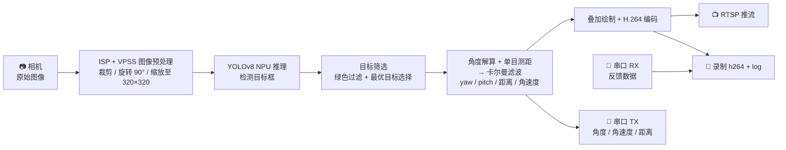

# DartVision

基于 LicheeRV Nano 的视觉识别与目标追踪项目，使用 Sophgo SDK 进行 NPU 加速推理（YOLOv8），结合卡尔曼滤波实现实时目标角度估计与单目测距。

## 整体流程



## 数据流总结

| 阶段 | 说明 |
|------|------|
| ISP + VPSS | 图像采集 → 裁剪 → 旋转 90° → 缩放至 320×320 |
| YOLOv8 NPU | 推理检测目标框 |
| 目标筛选 | 绿色 YUV 过滤 + 最优目标选择（置信度 + 位置邻近度） |
| 角度解算 + 测距 | 像素坐标 → 坐标变换链 → yaw/pitch 角度 + 单目距离 |
| 卡尔曼滤波 | 常速度 4 状态模型，确认/丢失状态机，输出平滑角度与角速度 |
| 叠加绘制 + 编码 | 检测框/追踪线/速度箭头绘制 → H.264 硬件编码 |
| RTSP 推流 | 320×320 H.264 实时视频流 |
| 串口 TX | 发送 yaw / pitch / 角速度 / 距离给下位机 |
| 录制 | H.264 码流 (record_XXXX.h264) + 反馈日志 (log_XXXX.txt) |

## 项目结构

```
DartVision/
├── CMakeLists.txt          # CMake构建配置
├── .clangd                 # clangd LSP配置
├── README.md
├── build/                  # 编译输出目录
│   └── bin/
│       └── dart_vision     # 可执行文件
├── src/                    # 源代码
│   ├── main.c              # 主进程：初始化 → 启动线程 → 等待退出
│   ├── config.c            # 配置文件解析（JSON + 默认值）
│   ├── uart.c              # 串口收发线程（DetectionPacket / FeedbackPacket）
│   ├── tdl.c               # 推理线程：YOLOv8 → 绿色过滤 → 角度解算 → 卡尔曼
│   ├── venc.c              # 编码线程：叠加绘制 → H.264编码 → RTSP推流 → 录制
│   ├── kalman.c            # 卡尔曼滤波器（常速度4状态模型）
│   ├── cJSON.c             # JSON解析库
│   ├── serial/             # 串口通信协议栈
│   ├── middleware_utils.c  # 中间件初始化工具
│   └── sample_utils.c
├── include/                # 头文件
│   └── dart_vision/
│       ├── config.h        # 配置结构体 + 图像/模型常量
│       ├── state.h         # 线程间共享状态（检测结果 + 追踪输出 + 互斥锁）
│       ├── uart.h          # UART 线程接口
│       ├── venc.h          # 编码/绘制线程接口
│       ├── tdl.h           # 推理线程接口
│       ├── kalman.h        # 卡尔曼滤波接口
│       └── visual_data.h   # 通信协议数据包定义
├── config/                 # 配置文件
├── scripts/                # 脚本
├── assets/                 # 资源文件（含默认配置）
└── sdk/                    # SDK依赖
    ├── prebuilt/           # 预编译库
    │   ├── lib/
    │   └── usr/lib/
    ├── opencv/             # OpenCV头文件和库
    ├── tdl_sdk/            # TDL SDK头文件（NPU推理）
    ├── middleware/         # Middleware头文件（VI/VPSS/VENC/RTSP）
    ├── osdrv/              # OS驱动头文件
    └── cvi_rtsp/           # RTSP头文件
```

## 线程模型

```
main()
  ├── 初始化配置（命令行 + JSON）
  ├── 初始化 ISP / VI / VPSS / VENC / RTSP
  ├── 初始化 TDL（加载 YOLOv8 模型到 NPU）
  ├── 初始化 UART + 串口协议栈
  │
  ├── [TDL 线程]  run_tdl()
  │     ├── VPSS Chn1 取帧
  │     ├── YOLOv8 NPU 推理
  │     ├── 绿色过滤 → 最优目标选择
  │     ├── 角度解算 → 单目测距
  │     ├── 卡尔曼滤波（预测 + 更新）
  │     └── 写入共享状态 → 唤醒 UART 发送线程
  │
  ├── [VENC 线程] run_venc()
  │     ├── VPSS Chn0 取帧
  │     ├── 叠加绘制（检测框 / 追踪信息）
  │     ├── VENC H.264 编码
  │     ├── RTSP 推流
  │     └── 可选录制到磁盘
  │
  ├── [UART 发送] run_uart_send()
  │     ├── 等待卡尔曼更新通知（条件变量）
  │     └── 发送 DetectionPacket → 下位机
  │
  └── [UART 接收] run_uart_recv()
        ├── 接收 FeedbackPacket ← 下位机
        └── 写入日志文件
```

## 通信协议

### 发送：DetectionPacket (CMD_ID 0x01)

| 字段 | 类型 | 说明 |
|------|------|------|
| `detected` | uint8 | 是否识别到目标 |
| `yaw` | float32 | 偏航角 (度) |
| `pitch` | float32 | 俯仰角 (度) |
| `v_yaw` | float32 | 偏航角速度 (度/秒) |
| `v_pitch` | float32 | 俯仰角速度 (度/秒) |
| `distance` | float32 | 目标距离 (米) |

### 接收：FeedbackPacket (CMD_ID 0x02)

| 字段 | 类型 | 说明 |
|------|------|------|
| `time` | float32 | 时间戳 |
| `acc` | float32 | 累积误差 |
| `pitch_err` | float32 | 俯仰误差 |
| `d_pitch_err` | float32 | 俯仰误差变化率 |

## 关键算法

### 坐标变换链

```
推理图 (320×320)
  → 乘 crop_scale → 旋转后坐标 (crop_size × crop_size)
  → 反旋转 90° CCW → 裁剪区域坐标
  → 加 crop_x/crop_y → 原始传感器坐标
  → 内参反算 → yaw / pitch 角度
```

### 卡尔曼滤波器

- **模型**: 常速度 (CV) 4 状态模型
- **状态向量**: `[yaw, v_yaw, pitch, v_pitch]`
- **状态机**: 检测确认计数 (`min_confirm_frames`) → 丢失容忍窗口 (`lost_frames`) → 超时重置
- **丢帧容忍**: 短暂丢失检测时，卡尔曼持续预测，UART 继续发送预测结果

### 目标筛选策略

1. **长宽比过滤**: 排除 ratio > `aspect_ratio_thresh` 的非目标框
2. **颜色验证**: 遍历检测框十字交叉扫描线，检查 YUV UV 分量是否满足绿色特征 (U,V < threshold)
3. **最优选择**: 加权评分 = `confidence_weight × 置信度 + (1-confidence_weight) × 位置邻近度`
   - 位置邻近度基于卡尔曼预测位置与检测框中心的距离

### 单目测距

```
distance = sqrt(x² + y² + z²)
其中: z = f × TARGET_DIAMETER / pixel_diameter
     x = (px - cx) / fx × z
     y = (py - cy) / fy × z
```

## 依赖

- RISC-V 交叉编译工具链 (riscv64-linux-musl)
- Sophgo SDK 预编译库
- OpenCV (已包含在 sdk 目录)
- CMake 3.15+
- Ninja (可选，推荐)

## 编译

### 设置环境变量

```bash
export COMPILER=/opt/riscv64-linux-musl/bin
```

### 使用 Ninja 编译（推荐）

```bash
cd build
cmake -G Ninja ..
ninja
```

### 使用 Make 编译

```bash
cd build
cmake ..
make
```

## 运行

将编译好的可执行文件及配置文件传输到 LicheeRV Nano 开发板：

```bash
# 传输可执行文件
scp build/bin/dart_vision root@<板子IP>:/root/

# 传输配置文件
scp assets/files/root/config/camera_info.json root@<板子IP>:/root/config/
scp assets/files/root/config/config.json root@<板子IP>:/root/config/
```

在开发板上运行：

```bash
# 普通模式（带可视化叠加）
./dart_vision /path/to/yolov8n.model

# Raw 模式（无叠加，纯原始画面）
./dart_vision /path/to/yolov8n.model --raw
```

## 输出说明

| 输出 | 格式 | 说明 |
|------|------|------|
| RTSP 视频流 | H.264 320×320 | 含检测框、追踪线、速度箭头、角度/距离文字覆盖 |
| UART TX | DetectionPacket | 实时目标角度、角速度、距离，供下位机控制使用 |
| 录制文件 | record_XXXX.h264 | H.264 原始码流，与 RTSP 内容一致 |
| 日志文件 | log_XXXX.txt | UART 接收的反馈数据（带时间戳） |

## 配置说明

配置文件位于 `/root/config/config.json`，关键参数：

- `manual_exposure_time_us`: 手动曝光时间（微秒）
- `optical_axis_yaw_comp_deg` / `optical_axis_pitch_comp_deg`: 光轴补偿角度
- `model_thresh`: YOLOv8 检测置信度阈值
- `record_enable` / `record_dir`: 录制开关与目录
- 卡尔曼参数：`q_*` (过程噪声), `r_*` (测量噪声), `min_confirm_frames`, `lost_frames` 等
- `aspect_ratio_thresh`: 目标长宽比上限
- `confidence_weight`: 检测置信度与位置邻近度的加权系数

相机内参文件 `/root/config/camera_info.json`：
- `fx`, `fy`, `cx`, `cy`: 相机内参矩阵参数

## 开发

项目已配置 clangd 支持，可在支持 LSP 的编辑器中获得：
- 代码补全
- 语法检查
- 跳转到定义
- 函数签名提示

## 注意事项

- 本项目仅能在 LicheeRV Nano 或兼容的 RISC-V 开发板上运行
- 需要确保开发板上有对应的运行时库
- SDK 库路径已配置为 `/mnt/system/lib` 和 `/mnt/system/usr/lib`
- RTSP 推流默认地址配置在 middleware 初始化中
